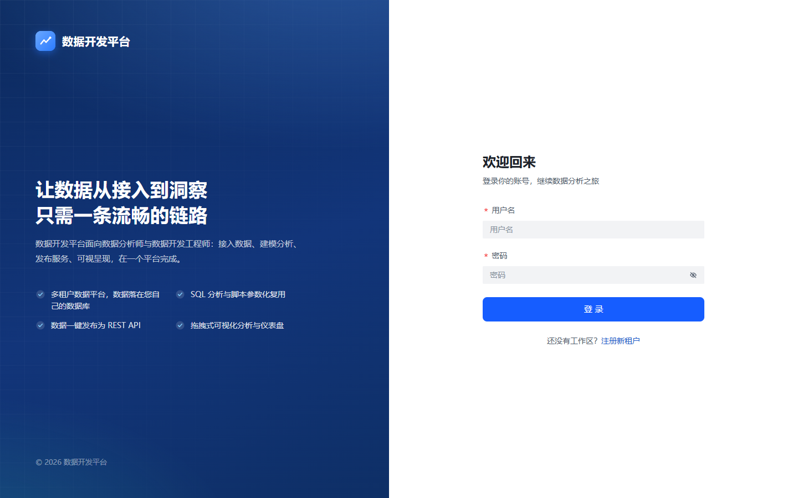
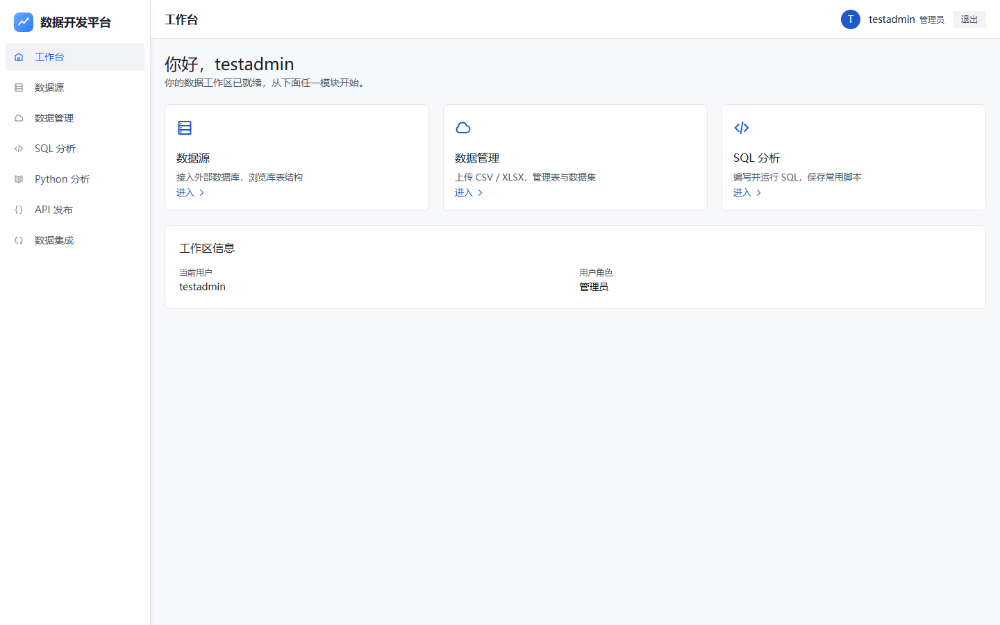
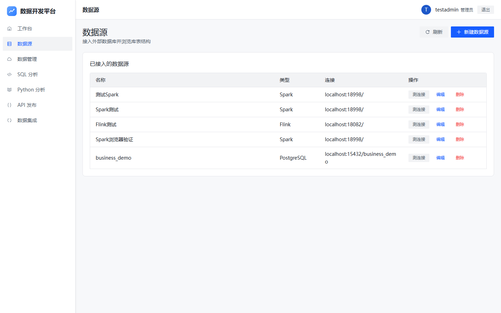
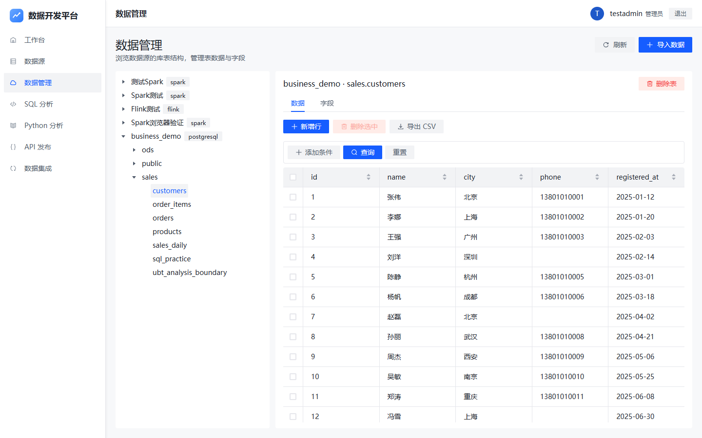
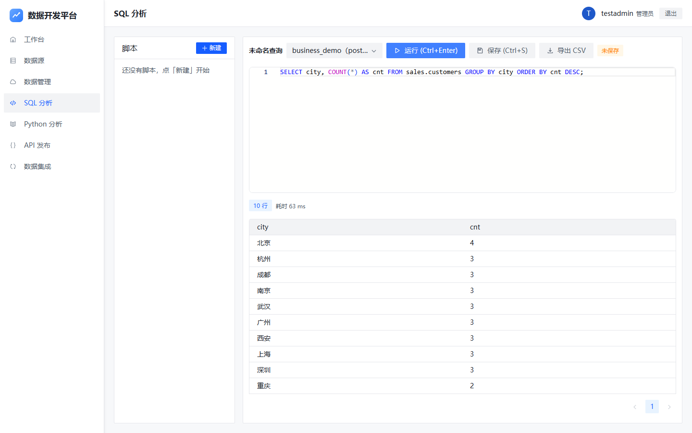
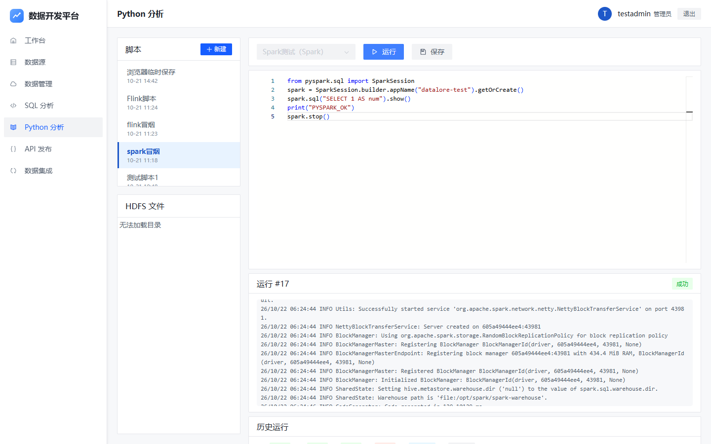
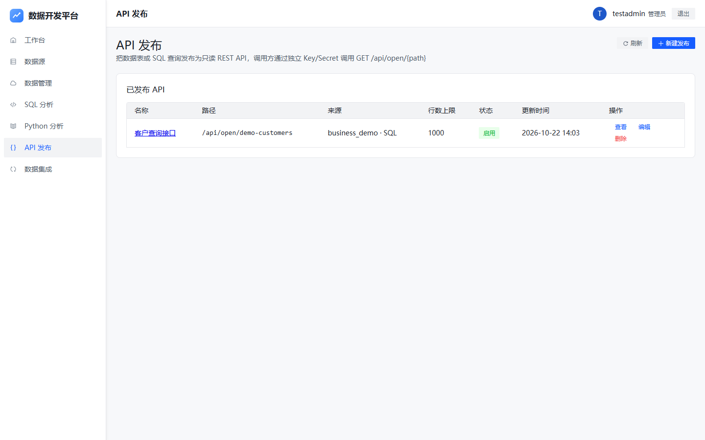
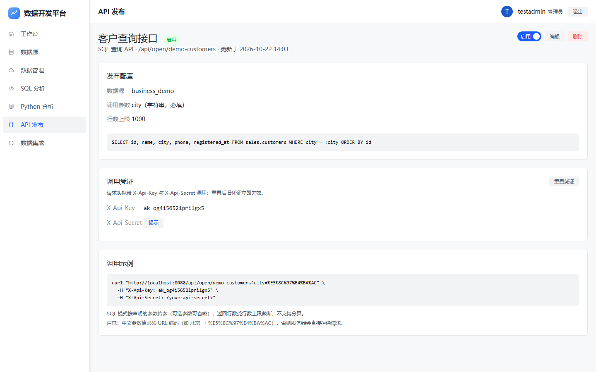
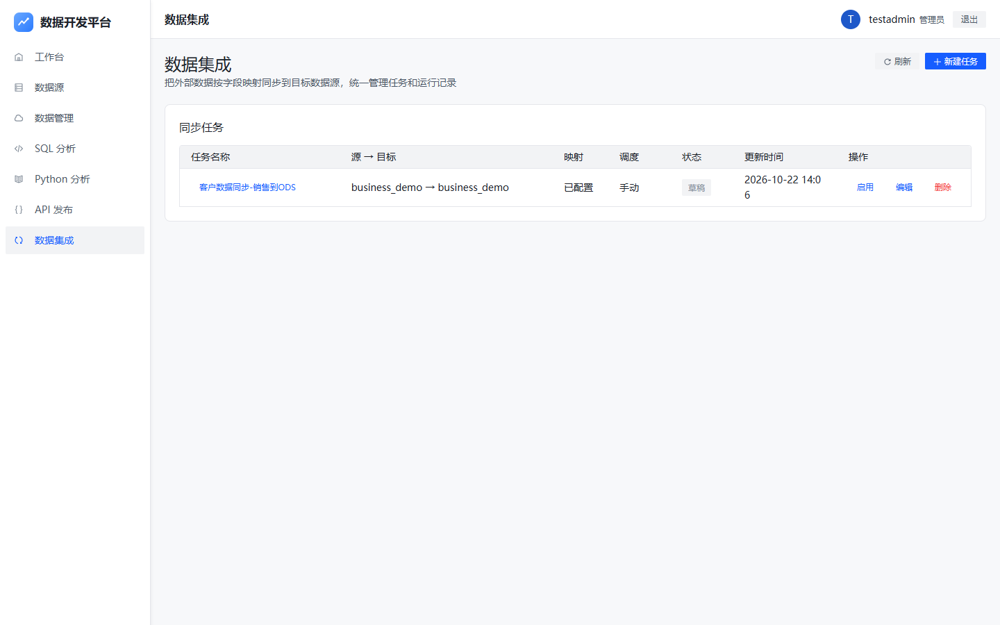
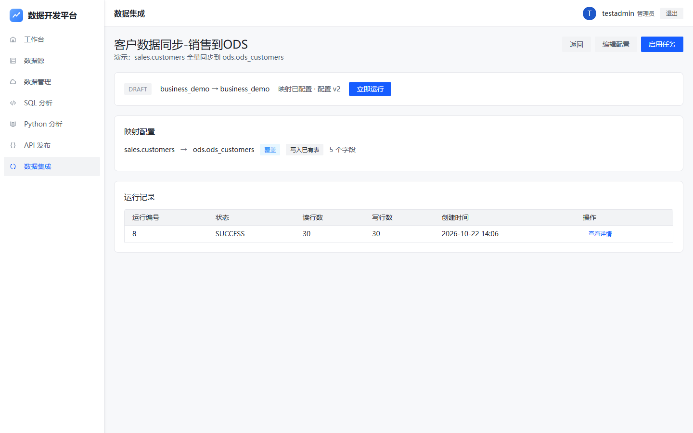

# Datalore — 数据开发平台

面向数据分析师与数据开发工程师的多租户数据开发平台。注册自己的数据库作为数据源后，即可完成数据浏览与编辑、SQL 分析、Python 分析（PySpark / PyFlink）、API 发布和数据集成（ETL），全程无需自建后端服务。

> 本项目仅供学习与演示使用。

## 功能特性

- **数据源管理** — 支持 PostgreSQL / MySQL / Hive 关系型数据源与 Spark / Flink 计算引擎登记，按类型动态适配连接表单，测连接 / 编辑 / 删除
- **数据管理** — 数据源 → Schema → 表树形浏览；表数据分页预览、条件筛选、排序、新增行、删除行、导出 CSV；字段结构查看与 DDL 编辑（新增 / 改名 / 改类型 / 删除，按数据源方言生成）；CSV 导入（自定义物理表名 / 追加已有表）；所有表支持引用检查 + 强制删除
- **SQL 分析** — Monaco 编辑器，脚本树管理、只读校验、30s 超时、10000 行截断、结果导出 CSV，支持 PG / MySQL / Hive
- **Python 分析** — PySpark 脚本经 Livy 兼容 REST API 提交到 Spark 集群真实执行；PyFlink 脚本经 Flink 集群 REST API 执行；实时日志输出与运行历史
- **API 发布** — 数据表模式（选表 + 暴露列 + 过滤列）与 SQL 模式（手写只读 SELECT，支持 `:param` 命名参数）；每个 API 独立 Key/Secret 凭证，AES-GCM 加密存储
- **数据集成** — 4 步向导：基本信息 → 源与目标 → 映射配置（拖拽连线字段映射）→ 调度与确认；支持 OVERWRITE / APPEND / UPSERT 写入策略与 SELECT 表输入
- **多租户** — 租户注册、登录鉴权、数据与脚本按租户隔离

## 界面预览

| | |
|---|---|
|  |  |
|  |  |
|  |  |
|  |  |
|  |  |



## 技术栈

| 层 | 技术 |
|---|---|
| 前端 | React 18 + Vite + Arco Design + Monaco Editor |
| 后端 | Java 17 + Spring Boot 3.3 + MyBatis-Plus + Flyway |
| 平台库 | PostgreSQL 16 + Redis 7 + MinIO |
| ETL 执行 | Python Worker（JDBC 批量写入，PostgreSQL 执行器） |
| 计算引擎联调 | Spark 3.5（mini-Livy REST）+ Flink 1.18（PyFlink），Docker Compose 可选 profile |

## 快速开始（开发模式）

前置要求：JDK 17、Maven、Node.js 18+、Docker。

```bash
# 1. 启动基础容器（PG 15432 / Redis 16379 / MinIO 19000,19001 / ETL Worker）
cd deploy
cp .env.example .env
docker compose up -d

# 2. 后端（端口 8080）
cd server && mvn spring-boot:run

# 3. 前端（端口 5173，已代理 /api → 8080）
cd web && npm i && npm run dev
```

访问 http://localhost:5173/datalore/ ，首次使用请先注册租户。

## Docker Release 部署（离线服务器）

```powershell
# 本地构建离线包（镜像 tar + release compose）
deploy/build-release.ps1
```

把 `deploy/release/` 下的镜像 tar 与 `docker-compose.release.yml` 拷到服务器，然后：

```bash
docker load -i datalore-images.tar
docker-compose -f docker-compose.release.yml up -d
```

Nginx 以 `/datalore/` 为基路径对外提供前端，API 反代到后端容器。

## 演示数据与手测用例

[docs/testdata/](docs/testdata/) 提供一套可反复重置的演示环境：

- `init-demo-db.sql` — 演示业务库 `business_demo`（sales / ods 两个 schema，约 2600 行真实感数据）
- `csv/` — 3 个导入练习文件（空值、bigint 推断、追加写入）
- `sql-practices.md` — 从简单查询到 JOIN / DDL / 原生报错 / 大结果截断的 SQL 练习集
- `手测用例.md` — 按模块分步的手测用例，含数据源、数据管理、SQL/Python 分析、API 发布、数据集成的完整操作步骤与预期结果
- `README.md` — 演示库重置命令与登记信息

## Spark / Flink 本地联调

```bash
cd deploy
docker compose --profile compute up -d   # Spark(Livy 兼容 REST) 18998 / Flink 18082
```

注册数据源时：

- **Spark**：类型选 Spark，主机 `localhost`，端口 `18998`（mini-Livy REST），可选填 WebHDFS 地址浏览 HDFS 文件
- **Flink**：类型选 Flink，主机 `localhost`，端口 `18082`（JobManager REST）

详细注册参数、示例 PySpark / PyFlink 代码见 `docs/testdata/手测用例.md`。

## 目录结构

```
server/            # Spring Boot 后端（datasource / datamanage / sqllab / pyscript / apipub / etl / tenant）
web/               # React 前端（/datalore 基路径）
deploy/            # Docker Compose、ETL Worker、compute 镜像（Spark/Flink）、release 构建脚本
docs/testdata/     # 演示数据、SQL 练习集、手测用例
docs/screenshots/  # README 截图
```

## 安全默认值

- `.env` 中的默认密码仅用于本地开发，部署前必须全部替换
- 数据源密码加密密钥：`openssl rand -base64 32` 生成，对应 `Datalore_CRYPTO_KEY`
- API 发布的 Secret 仅在生成 / 重置时展示一次，AES-GCM 加密落库
- SQL 网关保留单语句、超时、行数上限等运行保护；错误信息透传数据库原生消息
